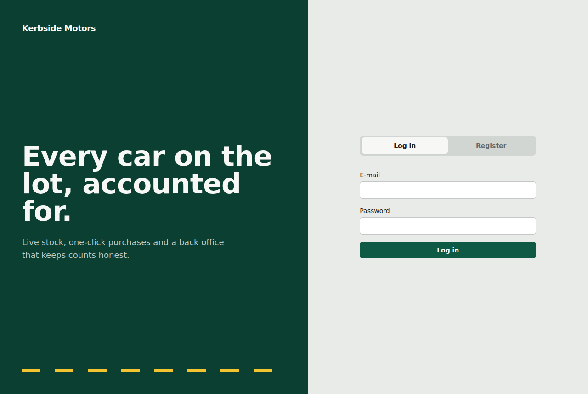
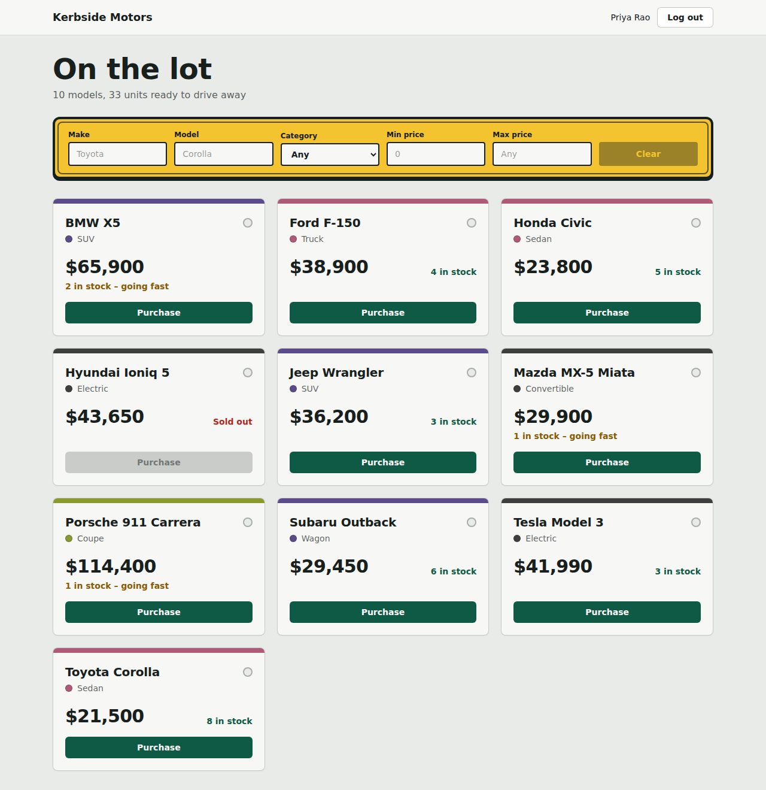
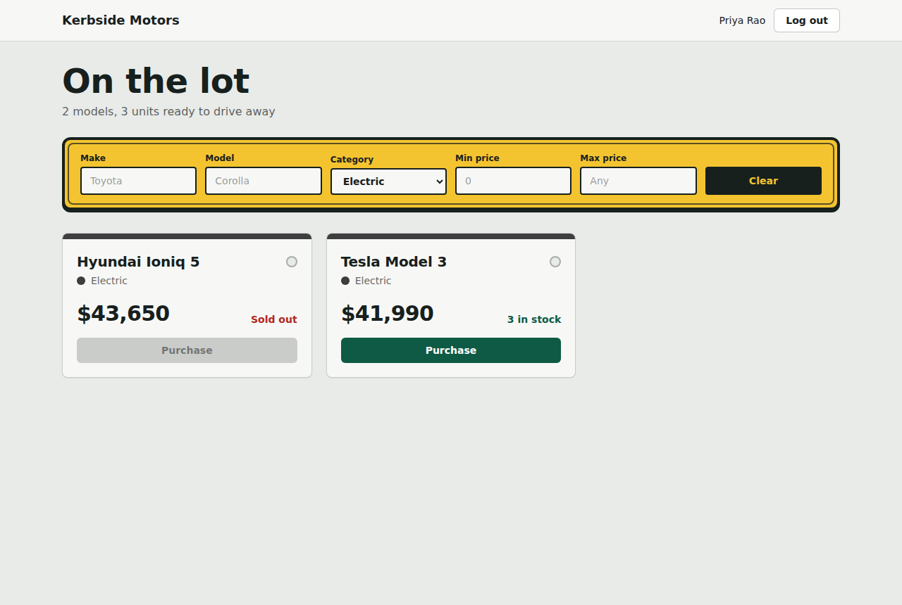
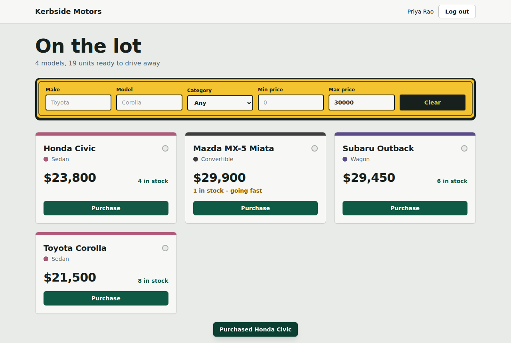
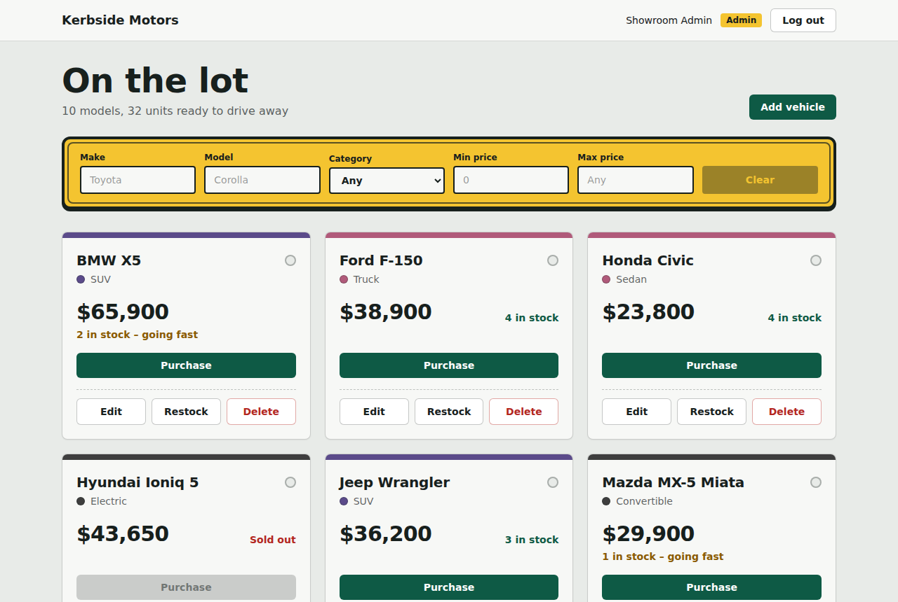
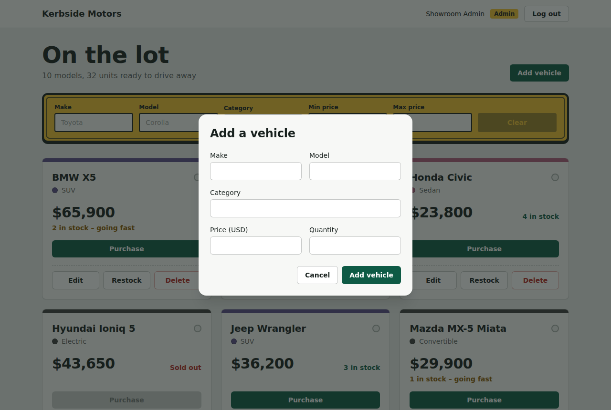

# Bharat Motors – Car Dealership Inventory System

A full-stack inventory app for a car dealership: a token-secured REST API with a persistent SQL database, and a responsive React single-page app for browsing, searching, purchasing and (for admins) managing vehicles.

| Layer | Stack |
| --- | --- |
| Backend | Node.js · TypeScript · Express · **SQLite file database** (`better-sqlite3`) · JWT · bcrypt · zod |
| Frontend | React 19 · TypeScript · Vite · **Tailwind CSS** · HTML5/CSS3 |
| Tests | Vitest · Supertest (API) · React Testing Library (UI) |

## Screenshots

| Login | Dashboard (user) |
| --- | --- |
|  |  |

| Filter by category | Purchase feedback |
| --- | --- |
|  |  |

| Admin view | Admin: add vehicle |
| --- | --- |
|  |  |

Mobile: [`docs/screenshots/08-mobile.png`](docs/screenshots/08-mobile.png) · Registration: [`02-register.png`](docs/screenshots/02-register.png)

> Screenshots were taken in a sandbox without internet access, so the Google-Fonts typefaces (Archivo / Public Sans) fell back to the system font. Run locally to see the intended typography.

## Running locally

### Prerequisites
- **Node.js**: `v20.x` or `v22.x` (LTS recommended; tested across Node 20.10+ and 22.x). If using `nvm`, run `nvm use` to automatically select the supported version.
- **npm**: `v9+` or `v10+`.

> **Node.js Compatibility Note:** The project dependencies (`better-sqlite3@^11.7.0`, `vite@^6.0.11`, `vitest@^2.1.8`) are configured to support both Node 20 and Node 22 without native compilation crashes or missing module errors.

### Quick Start

```bash
# 1. Install dependencies for both apps
npm run install:all

# 2. (Optional) Configure environment
# Sensible development defaults exist in backend/src/config.ts.
# To override:
cp backend/.env.example backend/.env    # On Windows: copy backend\.env.example backend\.env

# 3. Create the database, an admin user and sample cars
npm run seed
# Default Admin Login:
#   Email:    admin@dealership.test
#   Password: Admin@12345
# (Tip: run 'npm run seed -- --reset' anytime to reset the showroom inventory)

# 4. Start the backend API (http://localhost:4000)
npm run dev:backend

# 5. In another terminal, start the frontend SPA (http://localhost:5173)
npm run dev:frontend
```

Open [http://localhost:5173/](http://localhost:5173/) in your browser. The Vite dev server automatically proxies `/api` requests to the backend on `http://localhost:4000`.

**Production build:** `npm --prefix backend run build && npm --prefix backend start` and `npm --prefix frontend run build` (static files in `frontend/dist`).

**Running the tests:** `npm test` (runs both test suites) or `npm run test:report` to regenerate [`docs/test-report.md`](docs/test-report.md).

## API

All `/api/vehicles/**` routes require `Authorization: Bearer <jwt>`.

| Method & path | Access | Purpose |
| --- | --- | --- |
| `POST /api/auth/register` | public | Create an account (role is always `user`) |
| `POST /api/auth/login` | public | Returns `{ token, user }` |
| `GET /api/vehicles` | authenticated | List all vehicles (including sold-out ones) |
| `GET /api/vehicles/search` | authenticated | Query: `make`, `model`, `category` (case-insensitive partial), `minPrice`, `maxPrice` |
| `POST /api/vehicles` | authenticated | Add a vehicle `{make, model, category, price, quantity}` |
| `PUT /api/vehicles/:id` | authenticated | Partial update |
| `DELETE /api/vehicles/:id` | **admin** | Delete |
| `POST /api/vehicles/:id/purchase` | authenticated | Decrease stock (`{quantity?}` default 1); `409` if insufficient |
| `POST /api/vehicles/:id/restock` | **admin** | Increase stock `{quantity}` |

Errors are always `{ "error": "message", "details"?: [...] }` with 400 / 401 / 403 / 404 / 409 as appropriate.

### Design decisions
- **Layered architecture** – routes → services (business rules) → repositories (SQL). Dependencies are injected in `app.ts`, so tests run against a temporary *file* SQLite database (the brief forbids in-memory DBs).
- **No overselling** – purchase is a single guarded `UPDATE … WHERE quantity >= ?`, so concurrent buyers cannot drive stock negative.
- **No privilege escalation** – registration ignores any client-supplied `role`; admins are created by the seed script.
- **Access rules follow the brief literally**: add/update need a valid token; delete and restock are admin-only. The UI additionally hides all management controls from non-admins. Tightening add/update to admin only is a one-line change (`requireRole('admin')` in `vehicleRoutes.ts`).
- Login returns the same error for unknown e-mail and wrong password; SQL `LIKE` wildcards in search input are escaped.
- The session JWT is kept in `localStorage` for simplicity; an `httpOnly` cookie would be the hardening step for production.

## Test-driven development

The history follows Red → Green → Refactor: each `test(red): …` commit adds failing tests, followed by a `feat(green): …` commit that makes them pass, then `refactor: …`. See `git log --oneline`.

Latest results (full output in [`docs/test-report.md`](docs/test-report.md)):

| Suite | Result |
| --- | --- |
| Backend | 63 tests passing · 96.5 % statements / 87 % branches coverage |
| Frontend | 17 tests passing |

## My AI Usage

**Tools used:** Claude (Anthropic) & ChatGPT (OpenAI).

**How I used them:**
- **Claude:** Assisted in executing the TDD cycle (writing failing tests first, minimal passing implementations, and refactoring), structuring the layered architecture (Routes → Services → Repositories), and building the React + Tailwind frontend UI.
- **ChatGPT:** Used for kata requirement decomposition, formulating engineering prompts, brainstorming edge cases (e.g. atomic `UPDATE` to prevent overselling), and technical review.

**Reflection:**
- AI accelerated boilerplate setup, test writing, and UI scaffolding.
- Critical architectural decisions were explicitly guided, such as using atomic database queries (`UPDATE vehicles SET quantity = quantity - ? WHERE id = ? AND quantity >= ?`) rather than separate SELECT/UPDATE calls to eliminate race conditions, as well as enforcing strict role-based access control.

Raw chat logs: see [`PROMPTS.md`](PROMPTS.md).

## Deployment

The project is fully pre-configured for one-click deployment on **Render** (as well as Railway or Docker container). The Express server serves both the REST API (`/api/*`) and the compiled React single-page application (`frontend/dist`), eliminating CORS configuration and complex reverse-proxies.

- **Render Blueprint**: Configured via [`render.yaml`](render.yaml) with automatic environment variable generation and health checks (`/api/health`).
- **Complete Walkthrough**: See [`DEPLOYMENT.md`](DEPLOYMENT.md) for full step-by-step instructions.
